# RAHBAR

RAHBAR answers questions about public FAST-NUCES policies from indexed evidence. Its query API returns citations or declines to answer when retrieval cannot ground the response. The platform separates the API from indexing so the search index can be rebuilt independently of API deployment.

```mermaid
flowchart LR
    Browser --> Ingress
    Ingress -->|/| UI[nginx UI]
    Ingress -->|/api| API[FastAPI x3]
    API -->|read| Chroma[Chroma StatefulSet and PVC]
    API --> Redis[Redis Deployment and PVC]
    API -->|embed and generate| Ollama[Host Ollama]
    Corpus[Corpus PVC] --> Job[Indexer Job and weekly CronJob]
    Job -->|publish| Chroma
    Job -->|invalidate cache| Redis
    Job -->|embed| Ollama
    Config[Shared ConfigMap] --> API
    Config --> Job
```

[](https://github.com/i243086-dotcom/rahbar/actions/workflows/ci.yml)



## Local setup

Use Bash, Docker, minikube, kubectl, make and Python 3.12. On Windows, Ubuntu on WSL 2 with Docker Desktop integration is the simplest way to run the shell commands. All commands below run from the repository root. The cluster profile is `rahbar`.

```bash
make install PY=python3.12
make test
make lint
make cluster                     # MEMORY=3800 is an option on a smaller Docker VM
make images
kubectl config use-context rahbar
```

### Smoke test the platform with stubs

```bash
make apply OVERLAY=stub CORPUS=-
kubectl -n rahbar get pods,svc,ingress
```

The stub overlay selects a dummy index and suspends scheduled re-indexing. Open an Ingress port-forward in another terminal. This works on both Linux and Windows:

```bash
kubectl -n ingress-nginx port-forward svc/ingress-nginx-controller 8080:80
```

```bash
make ask INGRESS_IP=127.0.0.1:8080 Q="What does the stub retriever return?"
```

For the browser, resolve `rahbar.local` to 127.0.0.1 and open `http://rahbar.local:8080`. Save a screenshot of the production cited answer in `docs/evidence/` after the next step.

### Apply the real corpus

Run `OLLAMA_HOST=0.0.0.0 ollama serve` on the host, then pull `nomic-embed-text` and `llama3.2:3b`. For a Windows Ollama server, configure the listener in PowerShell with `$env:OLLAMA_HOST = "0.0.0.0"` before starting it. Set `OLLAMA_HOST_IP` to the address reachable from pods. Inspect `minikube -p rahbar ssh "grep host.minikube.internal /etc/hosts"` for the usual minikube address. With a Windows host serving Ollama to WSL, inspect `ip route | awk '/default/ {print $3}'` and confirm connectivity. The deploy script sets both the endpoint and its single-IP NetworkPolicy allowance from this value.

```bash
make fetch
.venv/bin/python corpus/fetch.py --verify
OLLAMA_HOST_IP="REPLACE_WITH_REACHABLE_IPV4" make apply
make ask INGRESS_IP=127.0.0.1:8080 Q="What CGPA puts a student on academic warning?"
make ask INGRESS_IP=127.0.0.1:8080 Q="How do I apply for a hostel room?"
make eval INGRESS_IP=127.0.0.1:8080
```

The deploy script runs `kubectl apply` in this order: namespace, service accounts and corpus claim, then the remaining workload manifests after a temporary Pod copies the corpus into the claim. It waits for Chroma and Redis, creates a uniquely named indexer Job and waits for completion, then refreshes and waits for the API rollout. The Job mounts the claim read-only. The source PDFs stay in the ignored `corpus/raw/` directory. Keep the [download manifest](corpus/MANIFEST.md) and fetch script in Git.

To rebuild the index from the files already on the claim, run `make index`. Wait for any existing indexer Job before starting a manual one. To refresh corpus files, run `make fetch` and `make apply` again with the same host IP after the current indexer has exited.

| Method | Path | Purpose |
| --- | --- | --- |
| POST | `/api/ask` | Cited answer or abstention |
| GET | `/healthz` | Process liveness |
| GET | `/readyz` | Chroma, collection, model pin and Redis checks |
| GET | `/metrics` | Prometheus request and pipeline metrics |

Only the query route is exposed through Ingress. Access the probe and metrics routes through an API pod or Service port-forward.

## CI and publishing

CI runs on pushes to `dev` and PRs into `dev` or `main`. It checks lint, tests and coverage, validates the production overlay, builds and scans all three images, and evaluates the fixture corpus through a kind Ingress. The fixture job uses a deterministic embedding endpoint and the stub generator so it measures retrieval, citation validity and abstention without depending on model downloads. Production quality is measured separately with Ollama and the real corpus.

The repository owner sets the `DOCKERHUB_USERNAME` and `DOCKERHUB_TOKEN` GitHub Actions secrets. CD publishes the three public Docker Hub images under the full commit SHA, then pulls those tags into a disposable smoke cluster. Require a reviewed PR and passing checks on `main`. Merge the Student B `platform` branch into `dev` first.

Hosted generation is optional. Use `make secret` to create the hosted key from the `LLM_API_KEY` environment variable and allow the selected provider in API egress policy. The checked-in placeholder is excluded from the overlay.

Follow the [Student B evidence checklist](docs/PLATFORM-DEMO.md) before submission.
